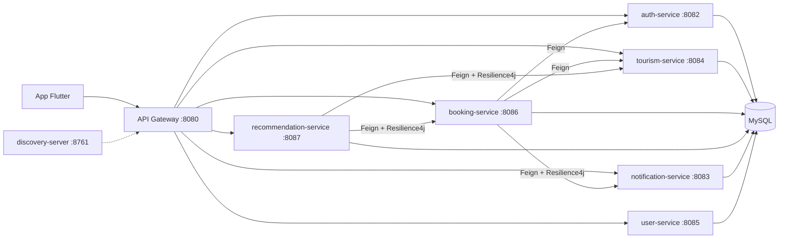

# Cap Teranga

Application mobile de tourisme intelligente pour découvrir le Sénégal : sites historiques, lieux religieux, nature, plages, hôtels et restaurants, avec des recommandations personnalisées et un générateur d'itinéraire jour par jour.

Backend en **microservices Spring Boot** (Eureka, API Gateway, JWT, Feign, Resilience4j), front **Flutter**, base **MySQL**, observabilité **Prometheus / Grafana / Zipkin**, le tout orchestré avec **Docker Compose**.

## Fonctionnalités

- Inscription / connexion JWT avec rôles `USER` et `ADMIN`
- Catalogue : 25 sites touristiques, hôtels, restaurants et plages, avec coordonnées GPS
- Exploration en swipe (hôtels, plages, restaurants) et fiches détaillées
- Recherche unifiée avec filtres : type, catégorie, ville, note minimale (insensible aux accents)
- Carte interactive avec marqueurs par type et filtres
- Avis et notes, avec calcul automatique de la moyenne par lieu
- Favoris synchronisés avec le serveur et consultables hors connexion
- Réservation d'hôtel avec statuts `EN_ATTENTE → CONFIRMEE / ANNULEE`, annulation côté client, validation côté admin, notification à chaque changement
- Recommandations personnalisées (voir plus bas)
- Itinéraire personnalisé : nombre de jours + centres d'intérêt + ville de départ → circuit jour par jour avec hôtel et restaurant suggérés
- Espace admin : gestion des hôtels, restaurants, plages et réservations

## Architecture



| Service | Port | Rôle |
|---|---|---|
| discovery-server | 8761 | Annuaire Eureka |
| api-gateway | 8080 | Point d'entrée unique, routage `lb://` |
| auth-service | 8082 | Comptes, rôles, émission des JWT |
| notification-service | 8083 | Notifications utilisateur |
| tourism-service | 8084 | Lieux, hôtels, restaurants, plages, avis, recherche |
| user-service | 8085 | Profils utilisateurs |
| booking-service | 8086 | Réservations et statuts |
| recommendation-service | 8087 | Favoris, recommandations, itinéraires |

## Lancer le projet

### Backend

Prérequis : Docker et Docker Compose.

```bash
cd backend
docker compose up --build
```

Le premier build prend quelques minutes (téléchargement des dépendances Gradle). Au démarrage :

- les tables sont créées par Hibernate et le jeu de données du Sénégal est chargé automatiquement ;
- les rôles `USER` / `ADMIN` et un compte admin sont créés : `admin@discover.sn` / `admin123` (modifiable avec les variables `ADMIN_EMAIL` et `ADMIN_PASSWORD`).

Eureka : http://localhost:8761

### Application Flutter

```bash
cd frontend/tourisme_app
flutter pub get
flutter run --dart-define=API_URL=http://<ip-de-ta-machine>:8080
```

Sur l'émulateur Android, utiliser `http://10.0.2.2:8080`. Sans `API_URL`, l'application vise `http://192.168.1.105:8080`.

## Recommandations

Filtrage basé sur le contenu, calculé dans `recommendation-service` à partir du catalogue de `tourism-service`.

1. **Profil utilisateur** : chaque interaction ajoute un poids à la catégorie, à la ville et au type du lieu concerné : réservation (+4), favori (+3), like (+2), dislike (−1,5), catégories déclarées (+2).
2. **Score d'un lieu** : `0,45 × affinité catégorie + 0,20 × affinité ville + 0,10 × affinité type + 0,25 × note / 5`, chaque affinité étant normalisée par le maximum du profil.
3. Les lieux déjà réservés ou en favoris sont exclus, et chaque suggestion est accompagnée d'une explication (« Parce que vous aimez les lieux historiques »).
4. **Cold start** : sans historique, l'utilisateur reçoit les lieux les mieux notés, en alternant les types pour éviter une liste de 10 hôtels.

`GET /recommendations/user/{userId}?limit=10&categories=NATURE,HISTORIQUE`

## Itinéraire personnalisé

`GET /recommendations/itinerary?days=4&categories=NATURE,AVENTURE&start=Dakar`

- sélection des sites selon les centres d'intérêt, puis regroupement par ville ;
- choix de la ville suivante en équilibrant intérêt et distance : `intérêt / (1 + distance_km / 150)` (distance de Haversine) ;
- remplissage des journées jusqu'à 7 h de visite, en fusionnant les visites courtes de villes à moins de 70 km ;
- pour chaque jour, l'hôtel le plus proche (60 km max) et un restaurant à proximité (30 km max).

## Observabilité et résilience

Lancés avec le reste de la stack :

| Outil | URL | Usage |
|---|---|---|
| Grafana | http://localhost:3000 | Dashboard « Cap Teranga » : requêtes/s, latence p95, erreurs 5xx, état des circuit breakers, mémoire JVM, connexions DB |
| Prometheus | http://localhost:9090 | Collecte des métriques `/actuator/prometheus` de chaque service |
| Zipkin | http://localhost:9411 | Traces distribuées (Micrometer Tracing + Brave), propagées dans les appels Feign |

Resilience4j protège les appels inter-services :

- **recommendation → tourism** : circuit breaker ; si tourism-service tombe, le dernier catalogue reçu est servi depuis le cache ;
- **recommendation → booking** : circuit breaker + retry, repli sur une liste vide ;
- **booking → notification** : retry avec backoff exponentiel + circuit breaker ; une réservation n'échoue jamais à cause d'une notification.

## API principale

| Méthode | Route | Accès |
|---|---|---|
| POST | `/auth/register`, `/auth/login` | public |
| GET | `/hotels`, `/restaurants`, `/beaches`, `/places`, `/categories` | public |
| GET | `/search?q=&type=&city=&category=&minRating=&maxPrice=` | public |
| POST/PUT/DELETE | `/hotels`, `/restaurants`, `/beaches`, `/places` | ADMIN |
| GET / POST | `/reviews?entityId=&entityType=` | public |
| POST | `/reservations` | connecté |
| GET | `/reservations/user/{id}` | connecté |
| PUT | `/reservations/{id}/cancel` | connecté |
| GET, PUT | `/reservations`, `/reservations/{id}/confirm` | ADMIN |
| GET / POST / DELETE | `/recommendations/favorites` | connecté |
| GET | `/recommendations/user/{id}`, `/recommendations/itinerary` | connecté |

## Données

Le jeu de données (`tourism-service/src/main/resources/data.sql`) couvre Dakar, Saint-Louis, la Petite-Côte, le Sine-Saloum, Touba, Tivaouane, Kaolack, la Casamance et le Sénégal oriental. Les coordonnées GPS sont approximatives et les prix des hôtels sont indicatifs.

## Crédits photos

Photos issues de Wikimedia Commons, sous licence libre. Les auteurs et licences exactes sont indiqués sur chaque page :

- Île de Gorée — [Ile-de-goree.jpg](https://commons.wikimedia.org/wiki/File:Ile-de-goree.jpg)
- Monument de la Renaissance africaine — [Monument_renaissance.jpg](https://commons.wikimedia.org/wiki/File:Monument_renaissance.jpg)
- Lac Rose — [Lac_Rose_in_Senegal.jpg](https://commons.wikimedia.org/wiki/File:Lac_Rose_in_Senegal.jpg)
- Grande Mosquée de Touba — [Touba_moschee.jpg](https://commons.wikimedia.org/wiki/File:Touba_moschee.jpg)
- Île de Saint-Louis — [Island_of_Saint-Louis-113799.jpg](https://commons.wikimedia.org/wiki/File:Island_of_Saint-Louis-113799.jpg)
- Pont Faidherbe — [Saintlouis_pont_Faidherbe.jpg](https://commons.wikimedia.org/wiki/File:Saintlouis_pont_Faidherbe.jpg)

Les autres lieux affichent un visuel de remplacement en attendant leurs photos.

## Pistes d'évolution

- Upload des photos vers Cloudinary
- Paiement mobile Wave / Orange Money
- Interface en wolof, français et anglais
- Déploiement Kubernetes (Minikube) avec probes `liveness` / `readiness`, déjà exposées par Actuator

## Auteure

Ndeye Maguette Kane — Master 2 Systèmes d'Information Répartis, FST-UCAD
